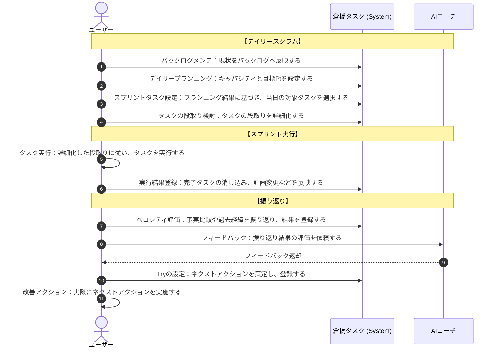
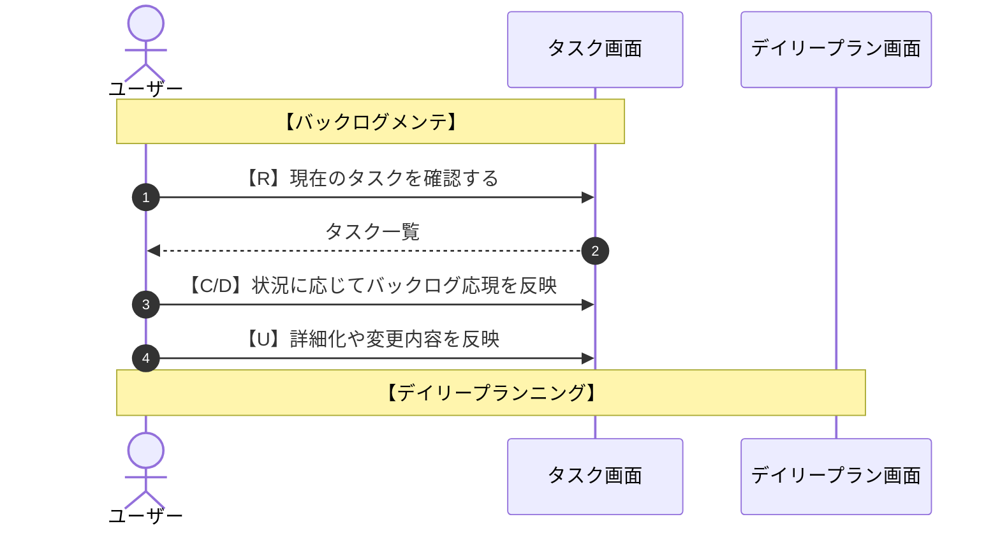
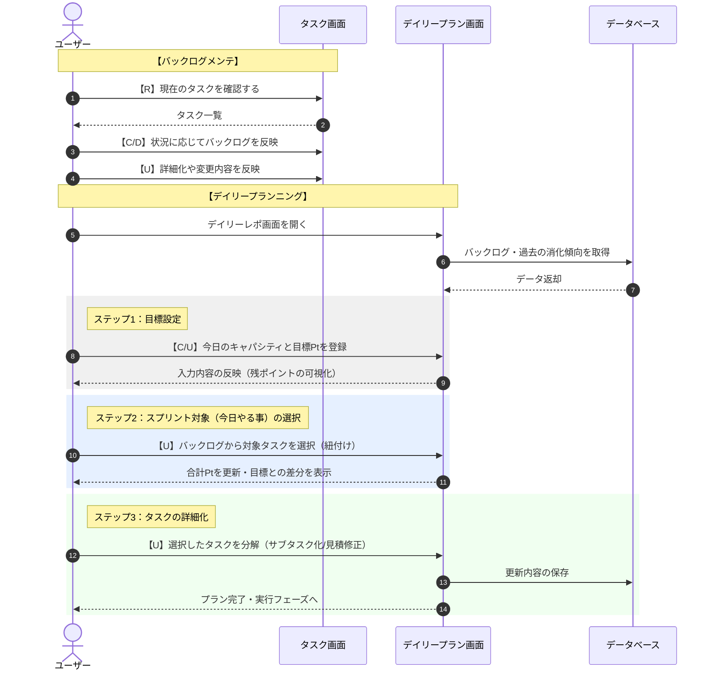

# アプリケーションコンセプト

## 用語定義（ドメイン）
- **実績ポイント**: 消化タスクから算出されるその日の生産性指標。
- **AIコーチング**: 実績に基づき、AIが翌日のアクションプランを提案するプロセス。
- **タスク粒度**: 思考を止めずに実行できるよう細分化された作業単位。

## 業務フロー


### デイリースクラム

タスク管理ツールの画面設計前にシナリオを整理している
シーケンス図で整理しているので続きを生成してほしい

■記載途中のシナリオ




### スプリント実行
```mermaid

```

### 昨日の振り返り
```mermaid

```


- タスクメンテ
  - タスク一覧画面での編集
    - 新規追加
    - 削除
    - 編集
      - 名称や内容などの詳細メンテ
  - デイリースクラム画面
    - 一覧メンテ
    - 優先度
    - ポイント変更


