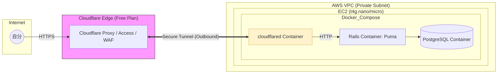

# インフラ設計

## 1. 概要

* 自分専用のRoRアプリケーション。
* **Cloudflare Tunnel** を活用し、EC2インスタンスをプライベート環境に置いたまま外部公開する。
* **費用最適化:** 常用しない時間はインスタンスを停止することで、Lightsailの固定費よりも安価な運用を目指す。
* **セキュリティ:** インバウンドポート（80, 443, 22）をすべて閉じ、Cloudflareのエッジ経由のみのアクセスを許可する。

## 2. 構成

### 構成図

### 構成要素

今回の構成変更で登場する各コンポーネントの役割を一覧にまとめました。
「外側（ユーザーに近い順）」から「内側（データに近い順）」に並べています。

-----

## インフラ構成要素 一覧

| 構成要素| 概要 |
| --- | --- |
| **Cloudflare Edge** | ユーザーに最も近い場所でリクエストを受け、高速な応答とキャッシュを提供します。|
| **Cloudflare Proxy / Access / WAF** | **Proxy(Cloudflare Tunnel):** パブリックIP・Elastic IP不要。ポートを全て閉じれるためセキュア **Access:** 自分だけがログイン可能とする **WAF:** 攻撃的な通信をエッジで遮断。 |
| **AWS VPC** | 仮想ネットワーク空間。 今回はTunnelを使うため、外部公開せず運用可能 |
| **EC2** | AWS上のサーバー|
| **Docker Compose**| App、DB、Tunnelといった複数のコンテナを、一つの設定ファイルでまとめて起動・管理します。|
| **cloudflared Container** | EC2の中からCloudflareへ向けて接続を確立します。 これがあるおかげで、**外向きのポートを全て閉じれる。**|
| **App Server (Rails)**| Rails（Puma）本体。 cloudflared Container から直接HTTPで受ける。 ビジネスロジックを実行し、HTMLやJSONを生成してユーザーに返す。 |
| **PostgreSQL**| コンテナとして動作し、アプリケーションのデータを保存します。 データはEBS（ストレージ）に永続化します。 |

## 3. 詳細スペック

| 項目 | 設定内容 | 備考 |
| --- | --- | --- |
| **インスタンス型** | **t4g.nano** (0.5GB) or **t4g.micro** (1GB) | コスパ重視。ビルド時のみmicroにするか、Swapで補填。 |
| **OS** | Ubuntu 24.04 LTS (ARM64) | 最新のLTS。Dockerビルド時に `linux/arm64` を指定。 |
| **Storage (EBS)** | 10〜20 GB (gp3) | 停止中もこの料金（月額100〜200円程度）のみ発生。 |
| **Elastic IP** | **不要** | Tunnelが起動時に自動でエンドポイントを確立するため、固定IPは不要。 |
| **Swap領域** | **2GB設定必須** | `t4g.nano` を選ぶ場合は特に、ビルド時のメモリ不足防止に必須。 |

## 4. セキュリティ

### ネットワーク層（Security Group）

* **インバウンド:** **全拒否 (None)**
* SSH (22) すら開ける必要はありません。
* **アウトバウンド:** **全許可 (ALL)**
* `cloudflared` が外部（Cloudflare）へ接続するために必要。

### Cloudflare層（Zero Trust / WAF）

* **Cloudflare Access:** 自分だけがログインできるように、メール認証（OTP）やGitHub連携を追加可能。
* **WAF Custom Rules:** 日本国外からのアクセス遮断など、エッジ側で防御。

## 5. 運用（コスト削減フロー）

### インスタンスの起動・停止

1. **作業開始時:** AWS Console または CLI から EC2 を `Start`。
2. **接続:** `cloudflared` が自動起動し、数分でドメイン経由でアクセス可能になる。
3. **作業終了時:** EC2 を `Stop`。これでコンピューティング料金が停止。

### デプロイ

1. `docker-compose.yml` に `cloudflared` サービスを追加し、Cloudflareから発行された `TUNNEL_TOKEN` を設定。
2. `docker compose up -d` でアプリと共にトンネルを立ち上げる。
