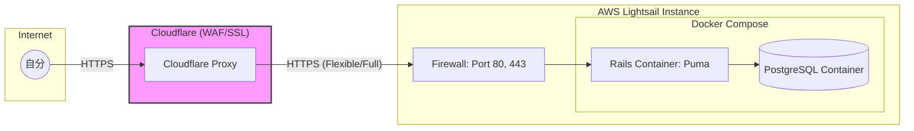

# インフラ設計

## 1. 概要

* 自分専用のRoRアプリケーション。
* **Cloudflare**をリバースプロキシ（CDN）として活用し、インフラ構成を最小化。
  * SSL終端、DDoS対策、IP制限などのセキュリティ機能をCloudflareに委ねる
  * サーバー側は**Docker Compose**（Puma直受け）でシンプルに構築する。

## 2. 構成

### 構成図



### 選定理由

| コンポーネント | 選定内容 | 備考 |
| --- | --- | --- |
| **Proxy / SSL** | **Cloudflare (Freeプラン)** | 証明書管理が不要。WAF（アクセス制限）もGUIで完結。 |
| **Compute** | Lightsail (Ubuntu) | Docker Engineを動かすホスト。 |
| **App Server** | **Puma (Rails直受け)** | Nginxを挟まないことでメモリ消費と管理対象を削減。 |
| **Database** | PostgreSQL (Container) | コンテナ内にデータを保持。 |

## 3. 詳細スペック

| 項目 | 設定内容 | 備考 |
| --- | --- | --- |
| **プラットフォーム** | Amazon Lightsail | 月額 $3.5〜$5.0 程度のプラン。 |
| **OS** | Ubuntu 22.04 LTS | Dockerのインストールが容易で情報が多い |
| **プラン** | 1GB RAM / 2 vCPUs | **Dockerエンジンとビルド時のメモリ消費**を考慮 |
| **Storage** | 40 GB SSD | 未使用イメージを定期削除（Prune）すれば十分な容量 |
| **Swap領域** | **2GB設定必須** | Dockerビルド時のメモリ不足を防止。 |
| **HTTPS化** | Cloudflare Flexible/Full SSL | サーバー側に複雑なSSL設定（Certbot等）が不要。 |

| **静的ファイル** | Rails (Puma) 配信 | `RAILS_SERVE_STATIC_FILES=true` に設定。 |

## 4. セキュリティ

「自分専用」を守るための設定をCloudflareとRailsの両層で行います。

### Cloudflare層（WAF設定）

* **アクセス制限:** Cloudflareの「WAF Custom Rules」を使用し、**自分のIPアドレス以外からのアクセスをブロック**、または**自分だけが知るカスタムヘッダー**を要求する。
* **Bot遮断:** 既知のクローラーや攻撃Botをエッジで遮断。

### ネットワーク層（ファイアウォール）

Lightsailの管理画面で以下のポート以外をすべて閉じます。

* **Port 80/443:** CloudflareのIP帯域からのみ許可するように設定（さらに安全にする場合）。
* **SSH (22):** 基本閉じ、ブラウザコンソールのみ許可。

### アプリケーション層（認証・認可）

* **MFA(多要素認証):** Rails側で `devise-two-factor` を実装。
* **Basic認証:** 必要に応じて `config/environments/production.rb` で設定。

### 秘密情報の管理

* **Docker Secrets / Env:** `docker-compose.yml` で環境変数を管理。
* **Credentials:** Railsの `master.key` はホストOS上の環境変数、またはコンテナ外のボリュームからマウント。

## 5. 運用手順

### デプロイ

1. ローカルで開発・テスト。
2. GitHubへPush。
3. サーバーへSSHログイン（ブラウザコンソール推奨）。
4. Lightsail上で `git pull`。
5. `docker compose up --build -d`（Pumaコンテナの更新と再起動）。
7. `docker compose exec app bundle exec rails db:migrate`。

### バックアップと復旧

* **スナップショット:** Lightsailの自動スナップショット（毎日1回）。
* **DBダンプ:** `docker compose exec db pg_dump` コマンドを使用して定期的にエクスポート。

### メンテナンス

* **Cloudflare管理:** 証明書の更新などはCloudflareが自動で行うため、ユーザー側の作業はゼロ。
* **キャッシュ削除:** フロントエンド（CSS/JS）を更新した際、Cloudflareの管理画面から「Purge Cache」を実行。

### 保守タスク（月1回推奨）

* **クリーンアップ:** `docker system prune -f` （未使用イメージ・ボリュームの削除）。
* **イメージ更新:** `docker compose pull` でベースイメージを最新化。

### 補足：JCOM（動的IP）環境でのSSH接続のコツ

- IP変動を気にせず済むよう、Lightsailブラウザコンソールを活用する
  - SSHクライアントの設定不要で、どこからでも安全に作業可能です。

## 実装メモ

Railsの `config/environments/production.rb` で以下の設定を忘れずに

1. **HTTPSの強制:**
```ruby
config.force_ssl = true

```
Cloudflareから見てHTTPSであれば、Rails側でもHTTPSとして振る舞うようにします。

2. **プロキシの信頼設定:**
Cloudflareはリバースプロキシとして動作するため、Rails側でCloudflareのIPを「信頼できるプロキシ」として登録しておくと、ログに正しいクライアントIP（自分のIP）が記録されるようになります（`rack-cloudflare` などのGemを使うと楽です）。

