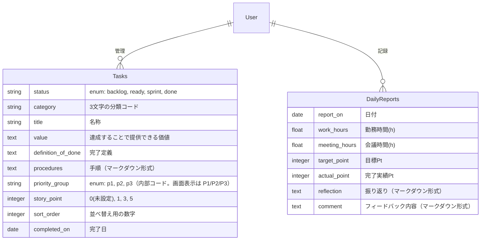

# DB・データ設計

## 1. テーブル設計 (ER図)

---

## 設計メモ

### 計算項目（集中時間・キャパシティPtなど）は永続化しない

これらは「勤務時間」と「会議時間」から一意に決まるため、**DBには保存しない。**  
Railsのモデル内でメソッド（計算ロジック）として実装する。  
これにより、後から「バッファを1.5hに変えたい」と思った時に、過去のデータを含めて一括で計算ルールを変更できるなどメリットがあるため。  

### 振り返り項目などの「長文テキスト」対応

フォーマットとして固まり切っていない項目なため、DB上は `text` 型（長文）で確保。  Rails側でマークダウン形式で保存できるようにすることで柔軟に対応することが狙い。  
将来的に「反省」と「改善アクション」を別カラムに分けたくなったとしても、マイグレーションで対応可能。

### Userテーブルとスコープ

- ER図上では `User` テーブルを定義し、`Tasks` / `DailyReports` と紐づく前提で設計している。
- **現時点の実装では、単一ユーザー専用アプリとして動作しており、`User` モデルおよび関連付けは未実装**。
- 当面は「自分専用」の前提で開発を進め、将来的に複数ユーザー対応が必要になったタイミングで `User` テーブルと外部キー（`user_id`）を追加する方針とする。

### カラム命名

基本的にはRails標準に合わせる
- 項目としてのID、作成日時、更新日時は自動生成されるため、テーブル定義には記載しない
- date(日付)の項目の名称は「～_on」
- time(日時)の項目の名称は「～_at」

### modelの実装

- enumのオプション「 _prefix: true」は必ず設定する
    - 特にデメリットがなく、明確になるため
- `Task` モデルでは、`priority_group` は内部的には `p1/p2/p3` の文字列を保存し、表示時に `P1/P2/P3` へ変換する。
- `story_point` は `0` を未設定（未見積もり）として扱い、実績値としては `1/3/5` を使用する。
