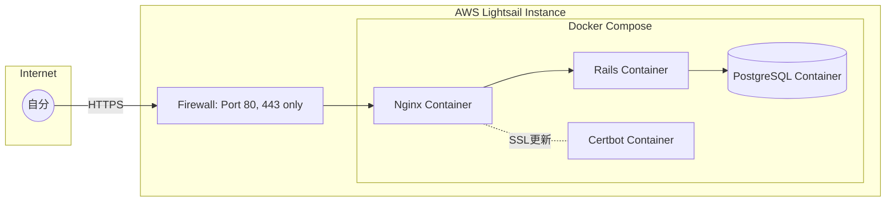

# インフラ設計書：[倉橋タスク]

## 1. 概要

* 自分専用のRoRアプリケーション。
* **Docker Compose** を利用し、環境構築・デプロイの再現性を確保する。
* 運用負荷を最小限にし、サーバーレスに近い低コスト構成をとる。

## 2. 構成

### 構成図

### 選定理由

| コンポーネント | 選定内容 | 備考 |
| --- | --- | --- |
| インスタンス | Lightsail (OS: Ubuntu) | 1GB RAMプラン以上。Docker実行環境として利用。 |
| コンテナ管理 | **Docker Compose** | Rails/DB/Nginxをまとめて管理。ローカルと共通化。 |
| データベース | PostgreSQL (Container) | コンテナ化することでホストOSのセットアップを不要にする。 |
| SSL/TLS | Certbot (Container) | Nginxと連携し、自動更新をコンテナ内で完結させる。 |

## 3. 詳細スペック

低コスト（月額$3.5〜$5.0）でDocker + RoRを安定稼働させるための構成です。

| 項目 | 設定内容 | 備考 |
| --- | --- | --- |
| **プラットフォーム** | Amazon Lightsail | AWSの他サービスより定額で安価 |
| **OS** | Ubuntu 22.04 LTS | Dockerのインストールが容易で情報が多い |
| **プラン** | 1GB RAM / 2 vCPUs | **Dockerエンジンとビルド時のメモリ消費**を考慮 |
| **Storage** | 40 GB SSD | 未使用イメージを定期削除（Prune）すれば十分な容量 |
| **Swap領域** | **2GB設定必須** | **Dockerビルド時のメモリ不足回避**に極めて重要 |

## 4. セキュリティ

「自分専用」を担保するための多重防御設定です。

### ネットワーク層（ファイアウォール）

Lightsailの管理画面で以下のポート以外をすべて閉じます。

* **HTTPS (443):** 一般アクセス用
* **HTTP (80):** HTTPSへのリダイレクトおよびCertbot更新用
* **SSH (22):** 作業時のみ開放、または「ブラウザコンソール」を利用

### アプリケーション層（認証・認可）

* **SSL/TLS通信:** コンテナによるHTTPS化を常時適用。
* **MFA (多要素認証):** Rails側で `devise-two-factor` 等を導入。
* **Basic認証:** NginxコンテナまたはRailsアプリ側で設定し、外部アクセスを遮断。

### 秘密情報の管理

* **Docker Secrets / Env:** `docker-compose.yml` で環境変数を管理。
* **Credentials:** Railsの `master.key` はホストOS上の環境変数、またはコンテナ外のボリュームからマウント。

## 5. 運用手順

### デプロイフロー（Docker版）

1. ローカルで開発・テスト。
2. GitHubへPush。
3. サーバーへSSHログイン（ブラウザコンソール推奨）。
4. `git pull`。
5. `docker compose up --build -d` を実行（イメージ更新と再起動）。
6. `docker compose exec app bundle exec rails db:migrate`。

### バックアップと復旧

* **スナップショット:** Lightsailの自動スナップショット（毎日1回）。
* **DBダンプ:** `docker compose exec db pg_dump` コマンドを使用して定期的にエクスポート。

### 保守タスク（月1回推奨）

* **クリーンアップ:** `docker system prune -f` （未使用イメージ・ボリュームの削除）。
* **イメージ更新:** `docker compose pull` でベースイメージを最新化。

### 補足：JCOM（動的IP）環境でのSSH接続のコツ

- IP変動を気にせず済むよう、Lightsailブラウザコンソールを活用する
  - SSHクライアントの設定不要で、どこからでも安全に作業可能です。

