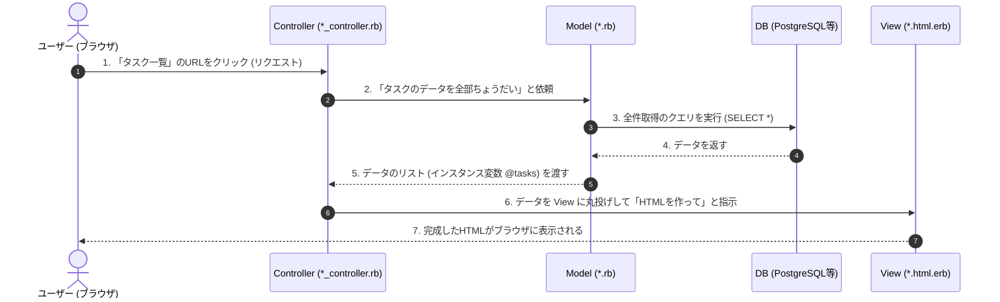

## 🏗 RailsのMVCサイクル（役割分担）

ユーザーがブラウザで操作してから画面が表示されるまでの流れを、**「レストラン」**に例えると非常にわかりやすくなります。

| 要素 | 役割（レストラン例） | 具体的な仕事内容 |
| --- | --- | --- |
| **Model (モデル)** | **調理場・在庫管理** | データの保存、計算、バリデーション（入力チェック）、DBとのやり取り。 |
| **View (ビュー)** | **盛り付け・お皿** | ユーザーが見る最終的な画面（HTML）。データを綺麗に並べて表示する。 |
| **Controller (コントローラ)** | **店員（司令塔）** | ユーザーの注文を受け、モデルに指示を出し、結果をビューに渡す仲介役。 |

---

## 🔄 3要素の連携イメージ図

### イメージ図

### 各ファイルの役割分担
今回のコードをベースに、それぞれのファイルがどう関わっているかを整理します。

|要素|ファイルパスの例|役割（一言で言うと）|今回のコードでの具体例|
|:----|:----|:----|:----|
|Model|app/models/task.rb|データのルール|Task.all（全件取得）や @task.save（保存処理）|
|Controller|app/controllers/tasks_controller.rb|全体の司令塔|index（一覧準備）や create（保存の成否による分岐）|
|View|app/views/tasks/*.html.erb|見た目（HTML）|render :new（作成画面表示）や turbo_stream（部分更新）|

### Railsの思想

### **「Fat Model, Skinny Controller（太ったモデル、痩せたコントローラ）」**

これはRails開発の鉄則です。

* **コントローラ**には「どっちの画面に行くか」という**手順**だけを書く（細かく書きすぎない）。
* **モデル**には「データの計算」や「複雑な並び替え」などの**ロジック**を書く。

こうすることで、コードが読みやすくなり、バグも減ります。

