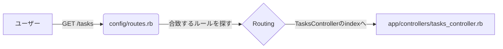

## 🚦 ルーティング（Routing）の役割

ユーザーのリクエスト（URL + HTTPメソッド）を解釈し、適切なコントローラーへ案内します。

### 🔄 ルーティングの基本フロー

---

## 🛠 `resources :tasks` が作る7つのルート

Railsでは `config/routes.rb` に `resources :tasks` とたった1行書くだけで、標準的な7つの窓口が自動で作られます。

今回共有していただいた `TasksController` の各メソッドと、URLの関係は以下の通りです。

| HTTPメソッド | URLパス | コントローラー#アクション | 役割 |
| --- | --- | --- | --- |
| **GET** | `/tasks` | `tasks#index` | **一覧表示** |
| **GET** | `/tasks/new` | `tasks#new` | 新規作成画面を表示 |
| **GET** | `/tasks/:id` | `tasks#show` | 1件の詳細表示 |
| **GET** | `/tasks/:id/edit` | `tasks#edit` | 編集画面を表示 |
| **POST** | `/tasks` | `tasks#create` | **保存処理**（DBへ書き込み） |
| **PATCH/PUT** | `/tasks/:id` | `tasks#update` | **更新処理** |
| **DELETE** | `/tasks/:id` | `tasks#destroy` | **削除処理** |

---

## 💡 ここがポイント！

### 1. URLが同じでも「動詞（メソッド）」で挙動が変わる

例えば、同じ `/tasks` というURLでも、

* **GET** なら「一覧を見せて」
* **POST** なら「新しく作って」
という具合に、Railsは**HTTPメソッド**を見てどのアクションを呼ぶか判断しています。

### 2. `:id` は「変数」

`/tasks/1` や `/tasks/100` の数字の部分が `:id` としてコントローラーに渡されます。
`TasksController` の `set_task` 内にある `params[:id]` は、このURLから抜き出した数字のことですね。

## 📝 メモ

「ルーティングは、URLという**住所**を見て、どの**部署（コントローラー）**の**担当者（アクション）**に繋ぐかを決める交換手である」と書いておくとイメージしやすいですよ！
