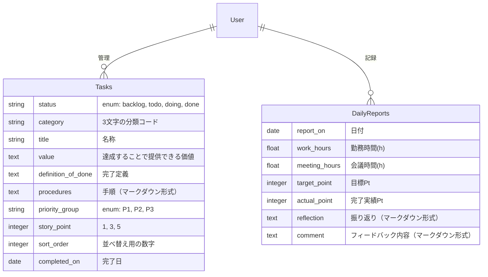

## 1. テーブル設計 (ER図)

---

## 設計メモ

### 計算項目（集中時間・キャパシティPtなど）は永続化しない

これらは「勤務時間」と「会議時間」から一意に決まるため、**DBには保存しない。**  
Railsのモデル内でメソッド（計算ロジック）として実装する。  
これにより、後から「バッファを1.5hに変えたい」と思った時に、過去のデータを含めて一括で計算ルールを変更できるなどメリットがあるため。  

### 振り返り項目などの「長文テキスト」対応

フォーマットとして固まり切っていない項目なため、DB上は `text` 型（長文）で確保。  Rails側でマークダウン形式で保存できるようにすることで柔軟に対応することが狙い。  
将来的に「反省」と「改善アクション」を別カラムに分けたくなったとしても、マイグレーションで対応可能。

### カラム命名

基本的にはRails標準に合わせる
- 項目としてのID、作成日時、更新日時は自動生成されるため、テーブル定義には記載しない
- date(日付)の項目の名称は「～_on」
- time(日時)の項目の名称は「～_at」

### modelの実装

- enumのオプション「 _prefix: true」は必ず設定する
    - 特にデメリットがなく、明確になるため
