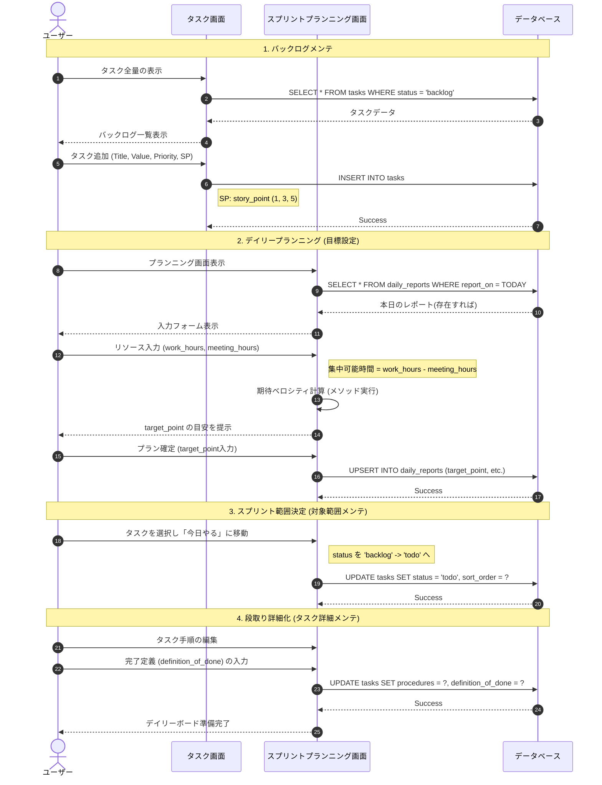

# シナリオ詳細：デイリースクラム

## 1. 目的

「今日一日の成果」を最大化するために、現状のバックログを整理し、自身のキャパシティに基づいた現実的な計画を策定する。

## 2. 詳細シーケンス図
システム（App）内でのデータの動きと、ユーザーの思考プロセスの流れを定義します。

## 3. 主要なデータ構造 (I/O)

このフェーズで扱う主要なデータ項目です。

| 項目 | 型 | 対応カラム / ロジック |
| --- | --- | --- |
| `target_point` | Integer | `daily_reports.target_point` |
| `work_hours` | Float | `daily_reports.work_hours` (入力値) |
| `meeting_hours` | Float | `daily_reports.meeting_hours` (入力値) |
| `status` | String | `tasks.status` ('backlog' ↔ 'todo') |
| `procedures` | Text | `tasks.procedures` (マークダウン) |

## 4. ロジック・制約事項（実装への落とし込み）

* **動的キャパシティ計算**: `daily_reports` モデルに `available_focus_time` メソッドを実装し、`(work_hours - meeting_hours)` を算出。これに基づき、推奨 `target_point` をフロントエンドに返す。
* **Enumの活用**: `tasks.status` は `_prefix: true` を設定し、`task.status_todo!` 等で直感的に遷移させる。
* **ポイントバリデーション**: `target_point` が過去の `actual_point` 平均値を大きく乖離する場合に警告を出す。

## 5. 画面設計メモ

* **プランニングView**: `daily_reports` の新規作成/更新フォームと、`tasks` のステータス一括更新（Drag & Drop）を一つの画面で行う。
* **マークダウンプレビュー**: `procedures`（手順）の入力中はリアルタイムでプレビューを表示し、段取りの具体化を促進する。
