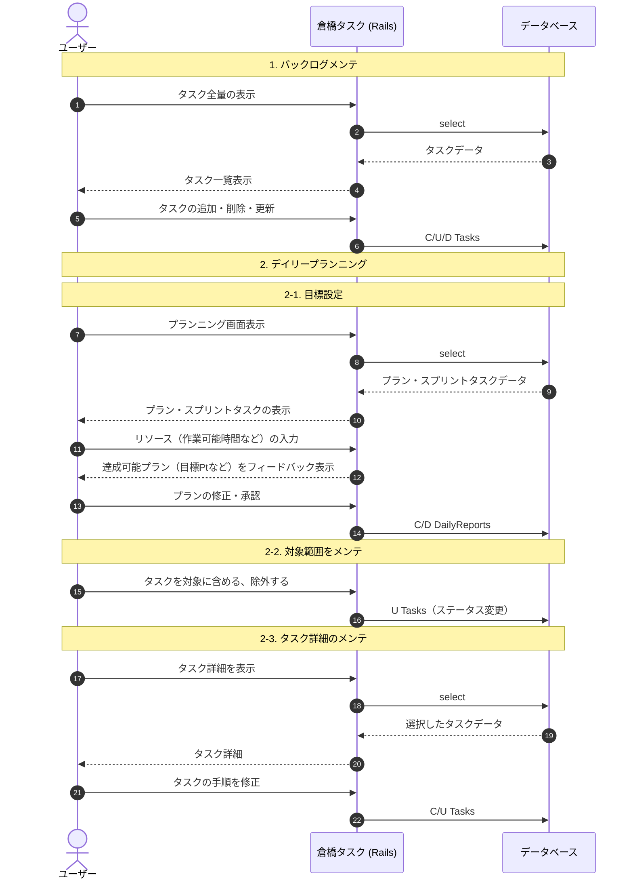

# シナリオ詳細：デイリースクラム

## 1. 目的
「今日一日の成果」を最大化するために、現状のバックログを整理し、自身のキャパシティに基づいた現実的な計画を策定する。

## 2. 詳細シーケンス図
システム（App）内でのデータの動きと、ユーザーの思考プロセスの流れを定義します。



## 3. 主要なデータ構造 (I/O)

このフェーズで扱う主要なデータ項目です。

| 項目 | 型 | 説明 |
| --- | --- | --- |
| `target_points` | Integer | その日の目標ポイント合計 |
| `capacity_score` | Integer | その日のコンディション（1-5） |
| `selected_task_ids` | Array[ID] | 今日実行するタスクのリスト |
| `subtasks` | JSON/Table | 段取り（チェックリスト）の内容 |

## 4. ロジック・制約事項

* **ポイントバリデーション**: `目標Pt` が `過去平均ベロシティ * 1.2` を超える場合、警告を表示する（無理な計画の防止）。
* **段取りの必須化**: 3Pt以上の重いタスクは、最低3つのサブタスクに分解することを推奨する。

## 5. 画面設計メモ

* **UI要素**: 左側にバックログ、右側に「今日のスプリント」を配置したドラッグ＆ドロップ形式。
* **ショートカット**: `N`キーで新規バックログ追加、`Enter`で確定。

```

---

## 💡 アドバイス：詳細設計を書く時のコツ

### 1. 「Railsの動き」を意識する
シーケンス図の `participant` に `DB` を入れたのは、**「いつデータベースに保存されるか」**を明確にするためです。個人開発では、ここが曖昧だと「フロントエンドで持っておくべきデータ」と「サーバーに送るべきデータ」の区別がつかなくなり、実装時に混乱します。

### 2. 「なぜそのデータが必要か」をロジック欄に書く
例えば「キャパシティ（体力）」を入力させるなら、単に保存するだけでなく「過去の平均と比較して警告を出す」といった**アプリの「賢さ（価値）」**に繋がるロジックをメモしておくと、開発のモチベーションが維持されます。

### 3. I/O 表は DB設計の種になる
ここにある「主要なデータ構造」を後でまとめるだけで、そのまま Rails の `Migration` ファイルを作る際の下書きになります。

---

この構成で、今のあなたのイメージとズレている部分はありますか？
特に**「段取り詳細化」**の部分など、もっと複雑なロジック（例えば既存のサブタスク テンプレートの適用など）が必要であれば、そこを深掘りしてシーケンス図を書き換えましょう！

