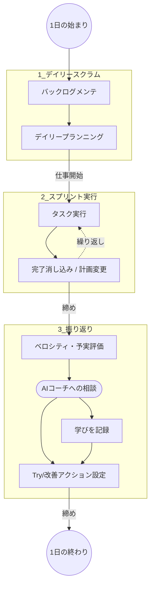

# 全体業務フロー (Global Flow)

## 1. 概要
このドキュメントでは、「倉橋タスク」における1日の標準的な業務サイクル（アジャイル開発手法ベース）を定義します。
システムは大きく「デイリースクラム（計画）」「スプリント実行」「振り返り」の3フェーズで構成され、AIコーチによるフィードバックループを回すことを目的としています。

## 2. システム俯瞰図（業務サイクル）
ユーザーが1日を通してシステムとどのように関わるか、全体像を可視化します。

## 3. 主要ユーザージャーニーとデータのやり取り

各フェーズの具体的なアクションと、発生するデータのやり取り（I/O）です。

| フェーズ | アクション | 主な操作対象データ (I/O) | 詳細ドキュメント |
| --- | --- | --- | --- |
| **デイリースクラム** | バックログの整理、本日の目標Pt設定、タスク選択と段取り作成 | `Backlog`, `DailyPlan`, `Task` | [計画シナリオ詳細](https://www.google.com/search?q=./daily_scrum_scenario.md) |
| **スプリント実行** | 実際のタスク消化、完了ステータスの更新、必要に応じた計画変更 | `Task` (status), `DailyPlan` | [実行シナリオ詳細](https://www.google.com/search?q=./sprint_exec_scenario.md) |
| **振り返り** | 予実の比較、AIへのフィードバック依頼、翌日以降のTry設定 | `Velocity`, `AIPrompt`, `ActionItem` | [振り返りシナリオ詳細](https://www.google.com/search?q=./retrospective_scenario.md) |

## 4. 共通のルール・制約

* **ポイント(Pt)管理**: タスクの重み付けは時間ではなくPtで行い、キャパシティ（ベロシティ）で1日の業務量をコントロールする。
* **AI連携**: 振り返りフェーズにおいて、外部のAI API（またはAIツール）を利用して客観的な評価を得る仕組みを持つ。

## 5. 関連リンク

* [コンセプト/背景](https://www.google.com/search?q=../concept.md)
* [データモデル (ER図)](https://www.google.com/search?q=../data_model.md)

